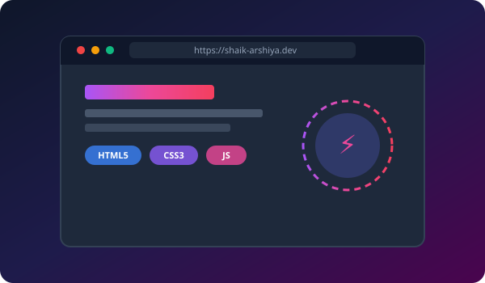

# Shaik Arshiya Begum — Personal Portfolio Website



A modern, production-grade personal portfolio website and full-stack web application designed for **Shaik Arshiya Begum**, B.Tech 3rd-year student specializing in **Artificial Intelligence and Machine Learning (CSE-AIML)** and aspiring Full Stack Developer.

Built with high-performance vanilla HTML5/CSS3/JavaScript, a scalable Node.js + Express REST API, MongoDB Atlas via Mongoose, and pre-configured for instant zero-config deployment to **Vercel** serverless functions.

---

## 🌟 Key Features

1. **Dynamic Hero Section:**
   - Interactive typing effect cycling through professional identities.
   - Live availability badge for internships & collaborations.
   - Direct CTA buttons & social links (LinkedIn, GitHub, Email).
   - Animated SVG developer illustration.
2. **About Me:**
   - Educational highlights in AI & ML, analytical problem-solving foundation, and full-stack engineering ambitions.
3. **Dynamic Categorized Skills:**
   - Skills stored in database and fetched via REST API (`/api/skills`).
   - Grouped into **Technical Skills** (Python, HTML & CSS, JavaScript), **Professional Skills** (Problem Solving, Communication, Teamwork), and **Creative Skills** (Web Design, App Design, Creative Thinking).
   - Smooth animated proficiency percentage bars powered by `IntersectionObserver`.
4. **Live Projects Showcase:**
   - Stored in MongoDB and fetched live via `/api/projects`.
   - Technology filtering pills (All, Python, JavaScript, HTML & CSS, MongoDB).
   - Featured badges, live demo links, repository buttons, and cover previews.
   - Built-in loading skeletons and retry error states.
5. **Secure & Rate-Limited Contact Form:**
   - Real-time client and server validation.
   - Rate limiting via sliding-window IP tracker to prevent spam.
   - Direct storage of inquiries into MongoDB Contact collection.
   - Instant visual feedback toasts (success / error).
6. **Dual Theme Engine:**
   - Seamless Dark and Light modes.
   - Glassmorphic card styling, gradient borders, and accent glow effects.
   - User theme preference persisted across sessions in `localStorage`.
7. **Admin Dashboard (`/admin`):**
   - Protected management interface unlocked by `ADMIN_KEY` (`x-admin-key` header).
   - Real-time system and database health status monitor.
   - Complete CRUD operations: Add new projects, edit existing entries, and delete obsolete projects with live table updates.
8. **Universal API Routing (Online & Local):**
   - The frontend strictly consumes relative URLs (`/api/projects`), ensuring seamless execution on `localhost`, custom domains, and Vercel serverless functions without CORS or URL mismatches.

---

## 📁 Exact Folder Structure

```
portfolio-website/
├── client/                     # Frontend static assets and views
│   ├── index.html              # Main portfolio landing page
│   ├── admin.html              # Admin project management panel
│   ├── css/
│   │   ├── style.css           # Modern glassmorphism & dual-theme stylesheet
│   │   └── admin.css           # Admin dashboard stylesheet
│   ├── js/
│   │   ├── api.js              # Universal relative API client
│   │   ├── main.js             # Client UI, typing animation, theme, & filters
│   │   └── admin.js            # Admin CRUD & auth gate logic
│   └── assets/
│       ├── favicon.svg         # Monogram SVG favicon
│       ├── avatar.svg          # Custom developer illustration
│       └── projects/
│           ├── academic.svg    # Banner for Academic Projects
│           ├── portfolio.svg   # Banner for Portfolio Website
│           └── ai_project.svg  # Banner for AI & ML coursework
├── server/                     # Backend Express.js REST API
│   ├── app.js                  # Main server entry & middleware pipeline
│   ├── config/
│   │   └── db.js               # MongoDB Atlas connection & resilient fallback
│   ├── controllers/
│   │   ├── projectsController.js # Projects CRUD & tech filtering
│   │   ├── skillsController.js   # Categorized skills provider
│   │   └── contactController.js  # Contact messages handler
│   ├── models/
│   │   ├── Project.js          # Mongoose Project Schema
│   │   ├── Skill.js            # Mongoose Skill Schema
│   │   ├── Contact.js          # Mongoose Contact Schema
│   │   └── dataStore.js        # Seed dataset & in-memory mirror
│   ├── middleware/
│   │   ├── auth.js             # x-admin-key validator
│   │   ├── rateLimiter.js      # Rate limiting protection
│   │   ├── validate.js         # Input sanitization & validation
│   │   └── errorHandler.js     # Centralized error handler
│   └── routes/
│       ├── projects.js         # /api/projects routes
│       ├── skills.js           # /api/skills routes
│       └── contact.js          # /api/contact routes
├── scripts/
│   ├── seed.js                 # Populates MongoDB Atlas with Arshiya's data
│   └── test_api.js             # Automated 15-point integration test runner
├── api/
│   └── index.js                # Vercel serverless function export
├── vercel.json                 # Vercel static & serverless routing config
├── package.json                # Project dependencies & npm scripts
├── .env.example                # Environment variables template
├── .env                        # Local environment configuration
├── .gitignore                  # Git ignore rules (.env, node_modules)
├── README.md                   # Complete documentation
└── DEPLOY.md                   # Step-by-step deployment guide
```

---

## 🛠️ Tech Stack

| Layer | Technologies |
|---|---|
| **Frontend** | HTML5, CSS3 (Modern Glassmorphism, CSS Variables, Flexbox/Grid), Vanilla JavaScript (ES6 Modules, Fetch API, IntersectionObserver) |
| **Backend** | Node.js, Express.js REST API |
| **Database** | MongoDB Atlas via Mongoose (with built-in resilient in-memory fallback for zero-downtime offline execution) |
| **Security & Utilities** | Helmet, CORS, Express-Rate-Limit, Custom Input Validator |
| **Cloud Deployment** | Vercel Serverless Functions (`@vercel/node`), Static Edge Hosting |

---

## 🚀 Quick Start (Local Setup)

### 1. Prerequisites
- **Node.js** (v18.0.0 or higher)
- **npm** (v9.0.0 or higher)

### 2. Installation
Open your terminal inside the project directory:
```bash
cd portfolio-website
npm install
```

### 3. Environment Configuration
Create your `.env` file (or copy from `.env.example`):
```bash
cp .env.example .env
```
Default `.env` contents:
```env
PORT=5000
NODE_ENV=development
MONGODB_URI=
ADMIN_KEY=arshiya-portfolio-admin-secret-2026
CORS_ORIGIN=*
```
*(Note: If `MONGODB_URI` is left blank, the app runs in resilient in-memory mode using pre-configured seed data, allowing immediate testing without external dependencies).*

### 4. Database Seeding (Optional for Atlas)
Once you have your MongoDB Atlas URI:
```bash
npm run seed
```

### 5. Running the Application
```bash
npm start
```
Open your browser at:
- **Portfolio Website:** [http://localhost:5000](http://localhost:5000)
- **Admin Dashboard:** [http://localhost:5000/admin](http://localhost:5000/admin)
- **Health Endpoint:** [http://localhost:5000/api/health](http://localhost:5000/api/health)

### 6. Running Integration Tests
Verify all 15 API endpoints, auth checks, and static file routers:
```bash
npm test
```

---

## 📡 REST API Reference

| Method | Endpoint | Protection | Description |
|---|---|---|---|
| `GET` | `/api/health` | Public | Returns system uptime and database connection status |
| `GET` | `/api/projects` | Public | List all projects; supports query `?tech=Python` and `?featured=true` |
| `GET` | `/api/projects/:id` | Public | Retrieve single project by ID |
| `POST` | `/api/projects` | `x-admin-key` | Create a new project (Admin only) |
| `PUT` | `/api/projects/:id` | `x-admin-key` | Update an existing project (Admin only) |
| `DELETE` | `/api/projects/:id` | `x-admin-key` | Remove a project (Admin only) |
| `GET` | `/api/skills` | Public | Retrieve skills grouped by category |
| `POST` | `/api/contact` | Rate-Limited | Validate, rate-limit, and submit contact message |

### Example: Create Project (Authenticated)
```bash
curl -X POST http://localhost:5000/api/projects \
  -H "Content-Type: application/json" \
  -H "x-admin-key: arshiya-portfolio-admin-secret-2026" \
  -d '{
    "title": "AI Plant Disease Classifier",
    "description": "Convolutional neural network for crop disease classification.",
    "techStack": ["Python", "TensorFlow", "FastAPI"],
    "githubUrl": "https://github.com/Arshiya-8055/plant-disease-ai",
    "featured": true
  }'
```

---

## 🔒 Security Best Practices
- **Never commit `.env`:** Keep your MongoDB credentials and `ADMIN_KEY` private.
- **Rate Limiting:** Protects the `/api/contact` endpoint against bot spam.
- **Helmet Headers:** Enforces modern Content-Security-Policy and prevents MIME-sniffing.
- **Zero Localhost Hardcoding:** Ensures frontend and backend integrate identically whether deployed on a custom domain, Vercel preview, or local machine.

---

## 👩‍💻 Author
- **Name:** Shaik Arshiya Begum
- **Degree:** B.Tech 3rd Year in CSE (Artificial Intelligence & Machine Learning)
- **LinkedIn:** [shaik-arshiya-begum](https://www.linkedin.com/in/shaik-arshiya-begum-9ab0a040a?utm_source=share_via&utm_content=profile&utm_medium=member_android)
- **GitHub:** [Arshiya-8055](https://github.com/Arshiya-8055)
- **Email:** [arshiyaaaa55@gmail.com](mailto:arshiyaaaa55@gmail.com)
